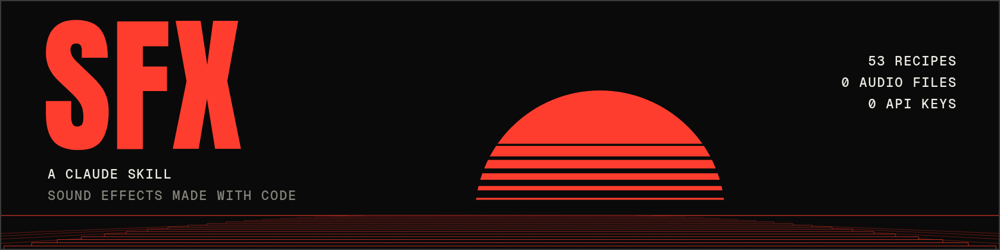

# sfx

A Claude skill that makes sound effects with code.

You ask for a sound. Claude writes it out as numbers, with numpy and scipy, and puts it on the frame it belongs to. There are no API keys, no AI models and no audio files in here.

**[Watch the video](https://www.youtube.com/watch?v=LUwq2TnbgGo)** (7 minutes): what a sound is made of, how it lands on a frame, and where the skill still fails. Every sound in it was made by the skill.

```
/plugin marketplace add latentastronaut/la-sfx-skill
/plugin install sfx@la-sfx-skill
```

Then ask for what you need:

- "Add a build-up and a hit where the title lands at 4.2 seconds."
- "Put a pop on each bullet as it appears."
- "I need rain under this scene, and a thunder clap when the door opens."

## What it needs

- [uv](https://docs.astral.sh/uv/), which fetches numpy and scipy the first time.
- ffmpeg, only if you want it to read sounds that aren't WAV.

Nothing else. Only two commands touch the network (`find` and `fetch`, which look up free recordings), and only when you ask for a found sound.

## Why code

- **It lands on the frame.** Every sound knows its own sync point (the hit in a riser, the pop after a swish). You give the time of the event and the file is built backwards from it, exact to the sample.
- **It fits.** A riser that has to be 2.2 seconds long is built at 2.2 seconds. Nothing is stretched.
- **It can follow the picture.** `--events` lists every raindrop, crackle or click in a sound with its time and position, so an animation can be drawn from the same numbers.
- **It repeats.** The same settings and seed give the same samples on any machine. A soundtrack is a list of times and settings.

## What it makes

53 recipes, plus 13 transforms for sounds you already have:

| Kind | Sounds |
|---|---|
| Video | hits, booms, risers, braams, whooshes, stingers, sub drops, a logo sting |
| Compounds, built round one sync point | riser into a hit, whoosh into a landing, typing, a count-up, a countdown, a glitch cut, a rewind |
| Interface | clicks, ticks, pops, chimes, notifications, error buzzes, sparkles |
| Signals and toys | alarms, phone tones, static, sci-fi, cartoon and 8-bit game sounds, a heartbeat, a clock |
| Ambiences that loop | rain, fire, wind, room tone, the sea, crickets, a stream, vinyl crackle |
| Events | thunder, an explosion, a spark, electrical arcing, pouring, footsteps on wood, concrete or dirt |

It also places sounds on a timeline from a cue sheet, checks a sound for faults, draws its spectrogram, compares it with a real recording, and builds a local page where you listen and choose.

## What it can't do

Claude can't hear. It can measure a sound and look at its spectrogram, and it will make you candidates, but you pick.

Some sounds fail when made this way: breaking glass, footsteps on grass, gravel or snow, engines, doors, and anything that should sound far away. For those the skill finds a free recording instead and tells you so. They are open problems, and [CONTRIBUTING.md](CONTRIBUTING.md) says how to have a go at one.

It doesn't make music or speech.

## Without the plugin

Copy `skills/sfx` into `~/.claude/skills/`. It also runs by hand:

```
uv run skills/sfx/scripts/sfx.py list
uv run skills/sfx/scripts/sfx.py make riser_hit lead=1.5
uv run skills/sfx/scripts/sfx.py make rain seconds=12 --events
```

Sounds are written to `./sfx/` as 48 kHz, 24-bit WAV, each with a small JSON file recording how it was made. Nothing is ever overwritten.

## How it was tuned

By ear. The ambiences were fitted to field recordings: measure the recording band by band, build to those numbers, compare the two spectrograms, then listen. [skills/sfx/references/ambience.md](skills/sfx/references/ambience.md) has the method. The data files in `scripts/data/` hold loudness curves measured that way and no audio.

## In the box

- [skills/sfx/SKILL.md](skills/sfx/SKILL.md): what Claude reads.
- `skills/sfx/scripts/`: the command and the recipes. `skills/sfx/references/`: timing, sound design, where free sounds can be had.
- `skills/sfx/tests/`: `uv run skills/sfx/tests/test_sfx.py`.
- `tools/measure/`: the scripts that measured the data files. `assets/src/`: the page that draws the banner and icon.
- [CONTRIBUTING.md](CONTRIBUTING.md), [AGENTS.md](AGENTS.md) (notes for coding agents), [SECURITY.md](SECURITY.md).

## Licence

MIT, for the code. The sounds you make with it are yours, with no licence attached.

Found recordings are a different matter: `fetch` records each one's source, author and licence beside the file. The audition page uses the Geist typeface (SIL Open Font License).
